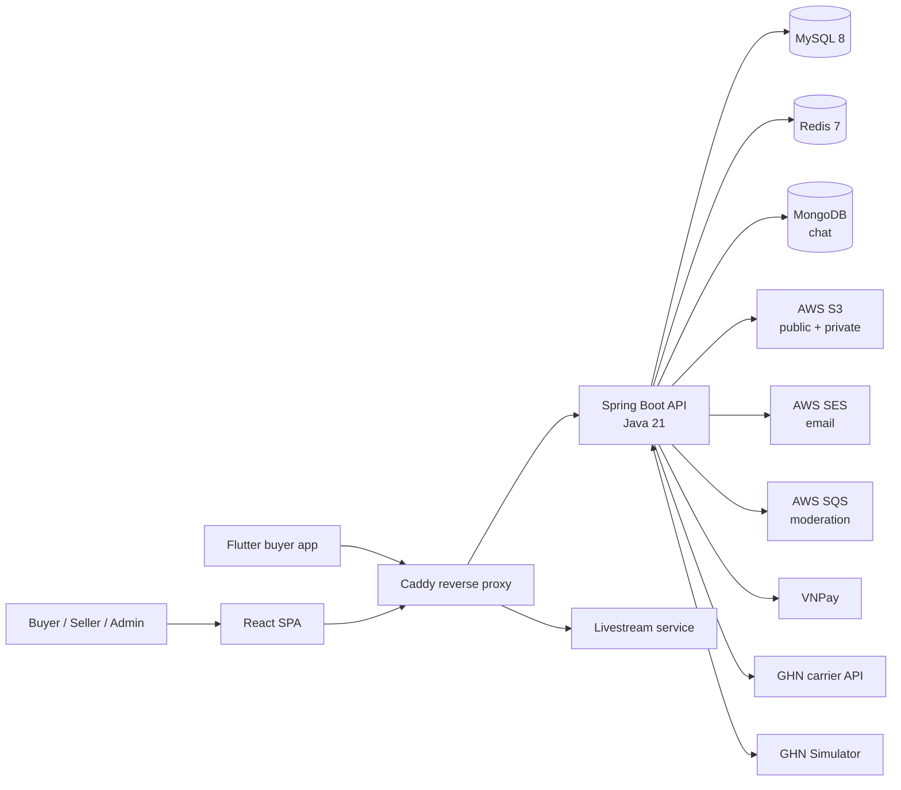
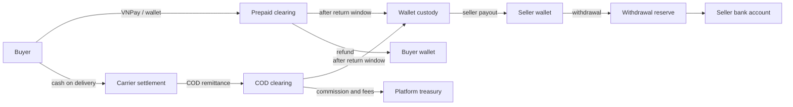

# Multi-Vendor E-Commerce (ShopE) Showcase

        

Public showcase repository for **ShopE**, a multi-vendor marketplace for buyers, sellers and admins. The storefront runs under the brand name SwiftCart.

Concept image. Real screenshots will be added once the demo deployment is live.

## At A Glance

| | |
|---|---|
| **Project type** | Aptech semester 4 team project, scored **99/100**, now extended as a personal project |
| **My role** | Team Lead and main developer across the backend, frontend and CI |
| **Scale** | ~380 REST endpoints · 142 Flyway migrations · ~680 test classes · CI split into 10 parallel shards |
| **Main stack** | Java 21, Spring Boot, Spring Security, Spring Data JPA, React, MySQL, Redis, MongoDB, AWS |
| **Source code** | Private. I am happy to walk through it in an interview |

## Quick Links

- [Overview](#overview)
- [My Contributions](#my-contributions)
- [Engineering Highlights](#engineering-highlights)
- [Architecture](#architecture)
- [Order And Money Flow](#order-and-money-flow)
- [Testing And CI](#testing-and-ci)
- [Tech Stack](#tech-stack)
- [Project Status](#project-status)
- [Author](#author)

## Overview

ShopE lets many independent shops sell in one marketplace, the way large Southeast Asian e-commerce platforms work:

- **Buyers** browse and search products, check out from several shops in one order, pay by VNPay, in-app wallet or cash on delivery, track shipments, request cancellations or returns, and review purchases.
- **Sellers** register a shop, pass identity verification (KYC), manage products and stock, and process orders and fulfilment.
- **Admins** review shops and products, handle disputes, moderate listings and reconcile payments and shipping.
- **Shipping** goes through the GHN carrier API. A self-built GHN Simulator stands in for the carrier during development, covering delivery, proof of delivery, COD collection and remittance.

The hardest part of the project is money: every payment, refund, payout and withdrawal goes through a double-entry style ledger so balances can always be proven.

## My Contributions

- Led the team, planned the work in phases and reviewed and merged the code
- Designed the backend architecture and the database schema, managed through Flyway migrations
- Built most of the REST API: checkout, vouchers, loyalty coins, returns, disputes and seller payouts
- Designed and implemented the money ledger and wallet custody model
- Integrated VNPay, GHN, AWS S3 / SES / SQS / Parameter Store and real-time chat
- Built the GHN Simulator so the full shipping and COD cycle can be tested without a real carrier account
- Set up the test strategy on Testcontainers and the sharded GitHub Actions pipeline

## Engineering Highlights

- **Multi-shop checkout:** one cart, split into one order per shop, with vouchers built on the Strategy pattern and loyalty coins
- **VNPay payments:** HMAC-SHA512 signature checks and idempotent IPN handling, so a callback that arrives twice never pays twice
- **Money ledger:** every wallet balance is backed by a platform custody account. Transfers are idempotent, locks are always taken in a fixed order to avoid deadlocks, and MySQL triggers reject any wallet write that has no matching custody movement
- **Seller payouts held until the return window closes**, with automatic recovery of seller debt from later payouts
- **Overselling guard in two layers:** a Redis availability gate, then an atomic conditional SQL update with an optimistic version column
- **Security:** JWT refresh-token rotation with reuse detection, Redis-based rate limiting, AES-GCM encryption for seller ID numbers and a private S3 bucket for KYC documents
- **Moderation:** SQS queues feed rule-based checks and optional AI review of new products
- **Real-time chat** between buyers and sellers over WebSocket, stored in MongoDB
- **Livestream selling** split into its own microservice, so thousands of open connections cannot slow down ordering

## Architecture

- The main API is a modular Spring Boot monolith with layered packages for controllers, services, repositories, security, integrations and scheduled jobs
- The livestream service and the GHN Simulator each have their own database and run as separate services
- Secrets come from AWS Systems Manager Parameter Store in the cloud profile, never from the repository
- Everything runs in Docker Compose behind Caddy, with an optional Cloudflare edge

## Order And Money Flow

Each arrow is a named ledger posting with an idempotency key. A readiness check proves that custody equals the sum of all wallet balances, and an admin can then switch on database-enforced wallet protection, with a reason and an audit trail.

The full COD cycle (seller-fault and platform-fault returns, automatic payouts, debt recovery and an emergency switch-off and back on) passed an end-to-end QA run on a separate database in October 2026, with custody matching total wallet balances throughout.

## Testing And CI

- Around **680 test classes**, with integration tests running on **Testcontainers MySQL** against the real production Flyway migrations
- Migration tests start from earlier schema versions to prove each upgrade works, and Hibernate schema validation guards the final schema
- **GitHub Actions** runs a fast tier (backend checks without a database plus frontend tests and build) on every push
- The full backend suite is split into **10 parallel shards**, balanced from recorded test timings, plus a two-system end-to-end tier with the GHN Simulator

## Tech Stack

- **Backend:** Java 21, Spring Boot, Spring Security, Spring Data JPA / Hibernate, Flyway
- **Frontend:** React, Vite, React Router
- **Mobile:** Flutter buyer app for Android (in progress)
- **Data:** MySQL 8, Redis 7, MongoDB 7, optional Meilisearch for search
- **Cloud:** AWS S3, SES, SQS, Systems Manager Parameter Store
- **Integrations:** VNPay, GHN shipping API
- **Ops:** Docker Compose, Caddy, GitHub Actions, Testcontainers

## Project Status

ShopE is under active development. Buyer, seller, admin, payment, shipping and ledger flows are in place and tested locally. The VPS deployment is being prepared, so there is no public demo URL yet. I can show it running locally on a screen share.

## Private Source Code Note

The full source code is private. This repository explains the product, architecture and my part of the work. If you are a recruiter, interviewer or reviewer, I can provide:

- a guided walkthrough of the code
- a live demo over screen sharing
- more detail on any design decision above

## Author

**Lê Văn Cảnh** · Java Full-Stack Developer · Ho Chi Minh City, Vietnam

- Portfolio: [canhle1993.github.io/canhle-portfolio](https://canhle1993.github.io/canhle-portfolio/)
- Email: [aplevancanh1993@gmail.com](mailto:aplevancanh1993@gmail.com)
- GitHub: [@canhle1993](https://github.com/canhle1993)
